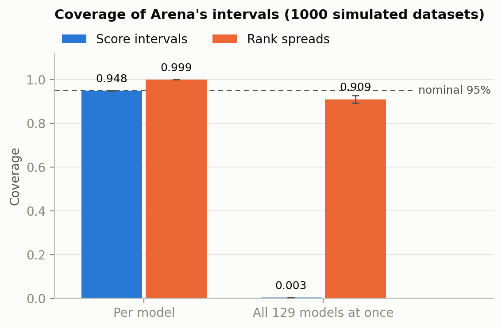
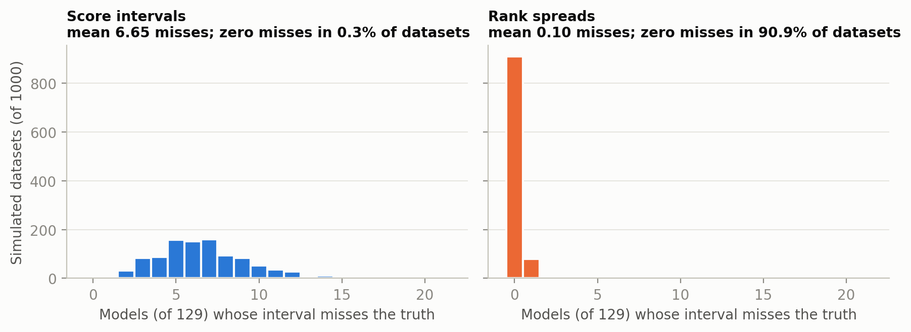
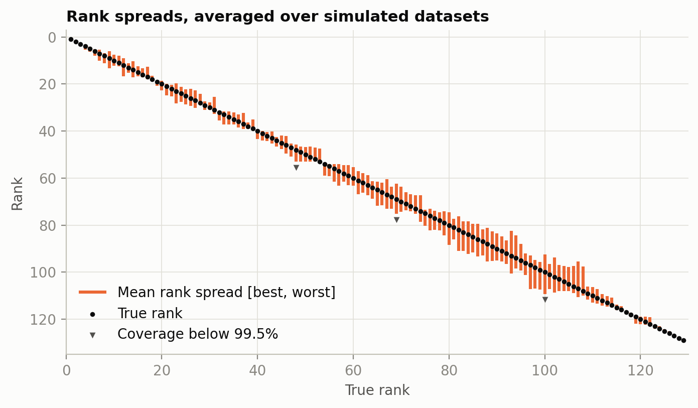
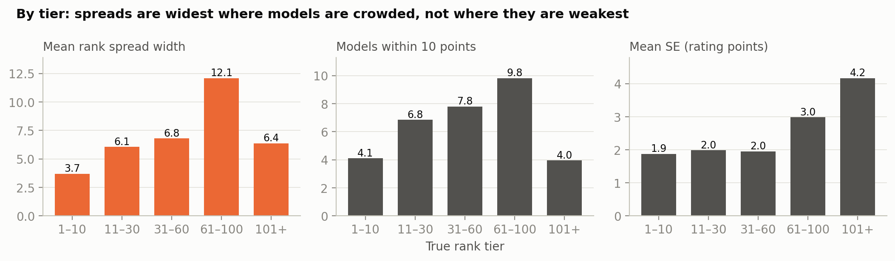
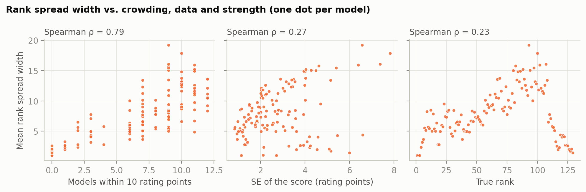

# Q1: How reliable is Arena's rank spread?

We simulated Arena using the 2024 battle data. Across 1,000 simulated datasets, a model's rank spread contained its true rank 99.9% of the time. The spreads for all 129 models were correct simultaneously in 91% of datasets. So if you read a spread as a statement about one model, it is much wider than it needs to be. If you read the whole leaderboard as one statement, it falls a little short of 95%.

## 1. The question

Arena gives each model a rank spread [best, worst], computed from 95% intervals [L, U] on the scores. A model's best rank is 1 plus the number of models whose L is above its U, i.e. models that are clearly better. Its worst rank is 1 plus the number of other models whose U is above its L, i.e. models that might be better.

In Step 0 we found that these intervals have no multiplicity correction. That causes two problems that push in opposite directions. First, each interval is a valid 95% interval on its own, but the rank spread uses all of them at once. With 129 models, around 6 or 7 intervals will miss their true score in any given dataset, so the intervals are too narrow for a statement about every model simultaneously. Second, the overlap rule is very conservative, because two models only get separated if their intervals don't overlap at all.

So Q1 asks: how often does the rank spread actually contain the true rank, both for individual models and for all models at once?

## 2. Simulation

We can't check this on real data because we don't know the true ranks. Instead we set up a world where we do know them and run Arena's method inside it.

First we fit Bradley–Terry on the real battles (1,657,517 battles, 129 models, same data as Step 0). We treat the fitted strengths as the truth, and their ordering as the true ranks. This is done once.

Each simulated dataset keeps the real matchups: the same 3,457 pairs of models, each playing the same number of battles as in the real data. Only the outcomes are redrawn from the true strengths. We keep ties at the real rate t = 34.5%. If p is the Bradley–Terry win probability, a battle is a win with probability p − t/2, a tie with probability t, and a loss with probability 1 − p − t/2. This keeps the expected score equal to p.

We then run arena-rank on the simulated data exactly as Arena would, compute the 95% intervals and rank spreads, and check them against the truth. We repeat this 1,000 times.

To keep the simulation fast, we draw each pair's win/tie/loss counts directly rather than simulating 1.66M individual battles; the two are equivalent. Every dataset also has the same shape, so arena-rank only compiles once. One fit takes about 0.2 seconds, and the full run takes about 3 minutes.

`test_simulate.py` checks two things:
- Our data format gives the same fit as loading the battles through arena-rank directly (differences around 1e-9).
- The simulated estimates are unbiased.

As a sanity check on realism, the simulated rank spreads have about the same average width as the real ones (8.0 vs 7.9 ranks).

## 3. Results



| | Per model | All 129 at once |
|---|---|---|
| Score intervals | 0.948 | 0.003 |
| Rank spreads | 0.999 | 0.909 ± 0.009 |

The score intervals behave as expected one at a time: each covers its true score about 95% of the time. Taken together they almost never all hold. On average 6.7 of the 129 miss, and all 129 covered in only 3 of the 1,000 datasets.

The rank spreads are much more robust. When a score interval misses, the rank spread usually doesn't change, since a model's rank only shifts when its interval completely clears a neighbour's. Out of 129,000 model-by-dataset checks, only 103 rank spreads missed.

So the two problems mostly cancel out. Joint coverage is 0.3% for the score intervals but 91% for the rank spreads. The gap from 95% is about 4.5 Monte Carlo standard errors, so it is real, but it isn't large. Wrong orderings were also rare. Using the site's rule (spreads that don't overlap), a wrong "A ranks above B" appeared in 6 of 1,000 datasets, and 90% of true orderings were picked up.



Our reading of this is that the rank spread isn't really calibrated to either interpretation. For a single model it is too conservative (99.9% rather than 95%). For the whole leaderboard it is slightly anti-conservative (91% rather than 95%). The 91% isn't something the method was designed to hit. It comes from two errors happening to offset each other, so we'd expect it to move if the number of models, their spacing, or the amount of data changes.

## 4. Which models have unstable ranks?

We also looked at which models' ranks move around most across the simulated datasets. We had no particular hypothesis going in.



| True rank | Spread width | Rank exactly right | Models within 10 points | SE |
|---|---|---|---|---|
| 1–10 | 3.7 | 77% | 4.1 | 1.9 |
| 11–30 | 6.1 | 48% | 6.9 | 2.0 |
| 31–60 | 6.8 | 43% | 7.8 | 2.0 |
| 61–100 | 12.1 | 30% | 9.8 | 3.0 |
| 101–129 | 6.4 | 57% | 4.0 | 4.2 |

Ranks are most stable at the top and bottom of the table, and least stable around ranks 61–100. The bottom group has the least data (largest SE) but its ranks are still fairly stable, because those models are spread far apart.



Correlations with spread width across the 129 models are below. A regression with all the factors at once gives the same picture.

| Factor | Correlation |
|---|---|
| Crowding (models within 10 rating points) | 0.79 |
| Amount of data (SE) | 0.27 |
| Strength (true rank) | 0.23 |
| Era (when the model was tested) | −0.18 |
| Sparsity (number of distinct opponents) | 0.04 |



The main driver is crowding: a model's rank is unstable when several other models have nearly the same true strength. More data helps too. Strength itself doesn't seem to matter once you account for these two. The top models look stable because they're spread out and have lots of battles, not because they're strong. We didn't find a clear effect of sparsity or era either, but every model here has at least 19 opponents and 1,193 battles, so we can't say much outside that range.

## 5. Limitations

- This is a single world: 129 models with 2024 strengths. The 2026 leaderboard has around 400 models and a crowded top. Section 4 suggests crowding is what hurts, so the picture could be worse there.
- The simulated data are idealized: battles are independent, outcomes follow Bradley–Terry exactly, strengths don't change over time, and there is one tie rate. In practice votes from the same user or on the same prompt may be correlated, and model strengths can drift. Either would likely push real coverage down.
- The "true" strengths are themselves estimates, so they are a bit more spread out than the real ones. That makes ranking slightly easier in the simulation than in reality.
- Section 4 is correlational. The factors are tangled up with each other; for example, older models tend to be weaker and have fewer battles.

## 6. Next steps

- Change the conditions directly to see how far joint coverage drops: move the true strengths closer together, cut the number of battles, or reshuffle who plays whom.
- Run fully synthetic worlds with more models (e.g. 200 or 400).
- For Q2, run the corrected methods (Bonferroni, χ², pairwise tests with Holm) through the same simulation and compare their coverage and width to the rank spread.

## Files

| File | What it does |
|---|---|
| `ranking.py` | arena-rank fit and the rank spread formula |
| `simulate.py` | the simulated world; `World.draw()` makes one dataset |
| `q1.py` | runs the simulation, writes `results/q1_summary.csv`, `q1_per_model.csv`, `q1.npz` |
| `q1_analysis.py` | Section 4, writes `results/q1_analysis_per_model.csv`, `log_q1_analysis.txt` |
| `q1_figures.py` | figures in `docs/figures/` |

```bash
python test_simulate.py
python q1.py --reps 1000
python q1_analysis.py
python q1_figures.py
```
